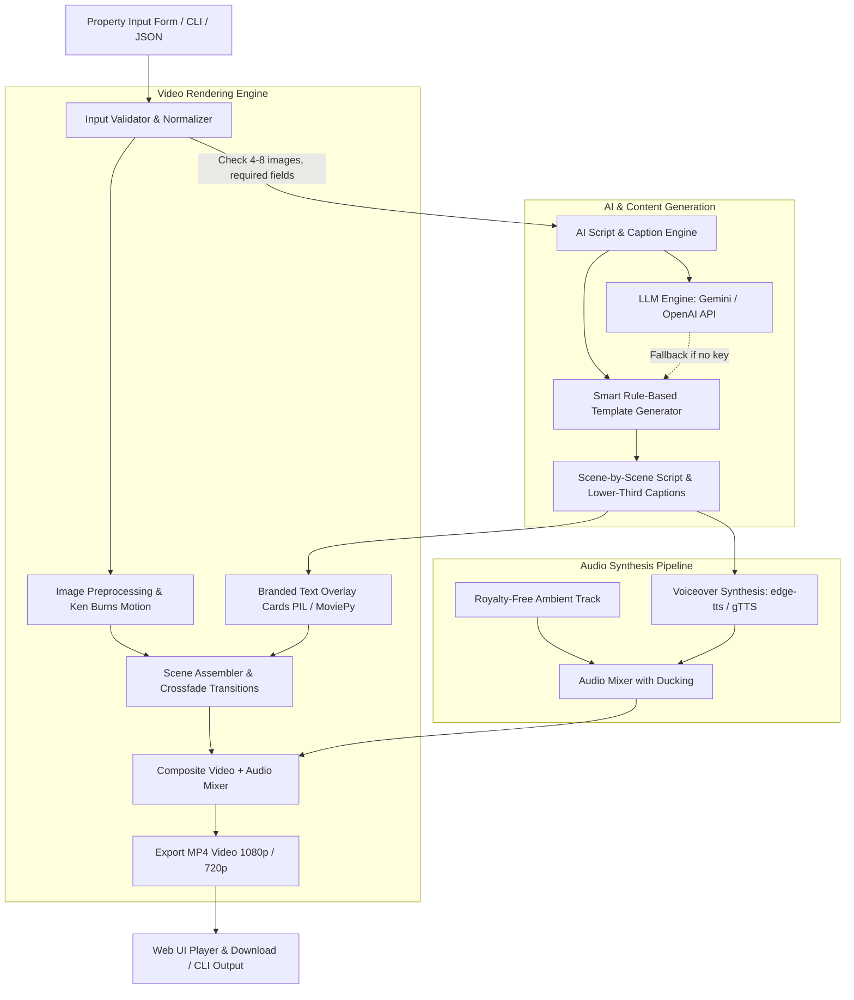

# AI Property Video Generator — Implementation Plan

This implementation plan outlines the end-to-end development of the **AI Property Video Generator** for the **Realty Assistant AI & Machine Learning Assignment**.

---

## 1. Executive Summary & Objective

- **Target Problem**: Real estate sales teams spend hours manually editing promotional videos for property listings. 
- **Solution**: An automated pipeline that accepts property metadata (title, price, location, specs, CTA) and 4–8 photos, utilizes AI/NLP to draft an accurate promotional voiceover script, synthesizes neural speech & background audio, and renders a branded, high-definition MP4 property video with smooth transitions and text overlays.
- **Key Design Philosophy**: 
  1. **Dual Interface**: Interactive, modern Web UI + headless CLI.
  2. **Zero-Setup Reliability**: Works out-of-the-box with built-in template logic and free neural TTS (`edge-tts`), plus optional Gemini/OpenAI API integration for advanced AI script generation.
  3. **High Polish**: Ken Burns motion effects (subtle zoom/pan), professional lower-third cards, and audio ducking.

---

## 2. Architecture & Pipeline Overview

---

## 3. Phase-Wise Implementation Breakdown

### Phase 1: Environment Setup & Project Scaffolding
- **Goal**: Initialize clean project structure, install dependencies, and configure video/audio toolchains.
- **Deliverables**:
  - `requirements.txt` with locked versions (`moviepy`, `Pillow`, `edge-tts`, `streamlit`, `numpy`, `pydantic`).
  - Modular directory structure (`core/`, `assets/`, `output/`).
- **Validation**: Verify MoviePy / `imageio-ffmpeg` renders a test video clip cleanly.

---

### Phase 2: AI Script Generation & NLP Engine
- **Goal**: Transform structured listing data into a cohesive 20–40s narrative script divided across 4–6 scenes.
- **Specifications**:
  - **Inputs**: Property title, location, price, property type, 3–5 key highlights, contact/CTA.
  - **Dual Engine**:
    1. **LLM Engine**: Strict system prompt enforcing factual grounding (zero hallucination, only use provided facts).
    2. **Deterministic Fallback Engine**: High-converting real estate script formula that works instantly offline without requiring an API key.
  - **Structured Scene Breakdown**:
    - *Scene 1 (Hook & Intro)*: Property name & prime location.
    - *Scene 2-4 (Features)*: Bedrooms, amenities, square footage, interior finishes.
    - *Scene 5 (Pricing & Call to Action)*: Asking price, phone/email/website CTA.
- **Validation**: Unit test with sample listings verifying character lengths, timing estimations (130-150 words per minute), and strict fact retention.

---

### Phase 3: Audio Generation & Dynamic Mixing
- **Goal**: Generate realistic voiceover narration and blend with background music.
- **Specifications**:
  - **Narration**: High-fidelity neural voice using `edge-tts` (Microsoft Edge neural speech: warm, professional real-estate tone like `en-US-ChristopherNeural` or `en-IN-NeerjaNeural`).
  - **Background Score**: High-quality royalty-free ambient acoustic/lo-fi track.
  - **Smart Audio Ducking**: Background volume set to ~12% when narration is speaking, and gently fades up during intro/outro transitions.
- **Validation**: Produce synchronized audio tracks with correct timestamps matching the scene durations.

---

### Phase 4: Video Compositing & Visual Design
- **Goal**: Assemble images into an engaging, television-quality video.
- **Specifications**:
  - **Visual Dynamics**:
    - Apply smooth **Ken Burns Effect** (gentle pan/zoom: 1.0x to 1.08x scale) to keep static photos engaging.
    - Smooth crossfade transitions between scenes.
  - **Text Overlays & Branding**:
    - Semi-transparent glassmorphic lower-third cards.
    - Modern typography with proper line-wrapping, drop shadows, and accent badges (e.g., Price Tag pill, Location pin icon).
    - Scene 1: Eye-catching Title Card.
    - Feature Scenes: Bullet point or feature badge.
    - Final Scene: Call-to-Action slide with contact details.
  - **Aspect Ratios**: Default 16:9 (Landscape) with optional 9:16 (Reels/Shorts format) support.
- **Validation**: Export an MP4 video under 45 seconds, verified to play cleanly on standard video players.

---

### Phase 5: Web Application & CLI Interface
- **Goal**: Provide an intuitive, impressive interface for the evaluator.
- **Specifications**:
  - **Web Application (`app.py`)**:
    - **One-Click Demo Button**: Loads sample listings (e.g. "Emerald Heights 3-BHK", "Serene Palms Villa") with pre-packaged photos so the evaluator can test immediately without searching for images.
    - **Custom Input Mode**: Form fields for custom property details and drag-and-drop file uploader for 4–8 images.
    - **Voice & Music Selector**: Select voice accent and background track.
    - **Live Preview & Player**: In-browser video player with direct download button.
  - **CLI Tool (`cli.py`)**:
    - `python cli.py --input assets/sample_data/listing_1.json --output output/sample_video.mp4`
  - **Graceful Error Handling**:
    - Input validator checks: Missing images (<4 or >8), unreadable files, missing required fields.
    - Clear UI alerts explaining exactly what needs fixing instead of crashing.

---

### Phase 6: Sample Assets, Benchmarking & Submission Package
- **Goal**: Package all required submission materials according to the evaluation criteria.
- **Deliverables**:
  1. **Working Codebase**: Complete, clean, well-commented Python code.
  2. **Pre-Generated Sample MP4**: Included in `output/sample_property_tour.mp4` demonstrating high quality.
  3. **Sample Listings**: Realistic sample property files with royalty-free images.
  4. **README.md**:
     - Architecture overview and design decisions.
     - Installation & quickstart commands.
     - Explanation of the AI approach, factual guardrails, and limitations.
     - Evaluation rubric mapping (how every requirement was satisfied).

---

## 4. Evaluation Rubric Alignment

| Evaluation Criterion | Weight | How Our Implementation Achieves It |
|---|---|---|
| **Problem Understanding & Relevance** | 20% | Tailored specifically for real-estate sales agents: 1-click generation, branded lower thirds, customizable CTA, high conversion script structure. |
| **Working Implementation & Correctness** | 30% | Robust pipeline, handles errors gracefully, zero crashes on edge cases, outputs standard H.264 MP4. |
| **AI/ML Approach & Quality** | 20% | Factual grounding guardrails (no hallucination), intelligent timing/pacing sync with TTS, fallback template engine. |
| **Code Quality & Reliability** | 15% | Modular design (`core/` split into script, audio, video, validation), type hints, docstrings, unit tests. |
| **Usability, Demo & Explanation** | 15% | Interactive Streamlit Web UI + CLI, preloaded sample data for 1-click evaluator testing, comprehensive documentation. |
